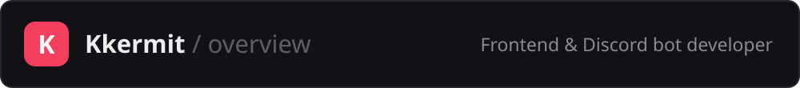
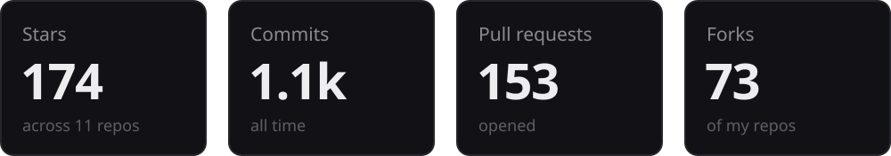
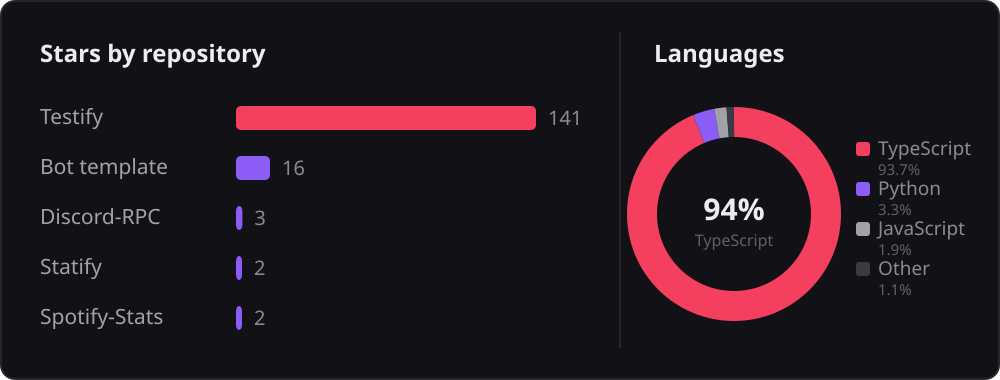
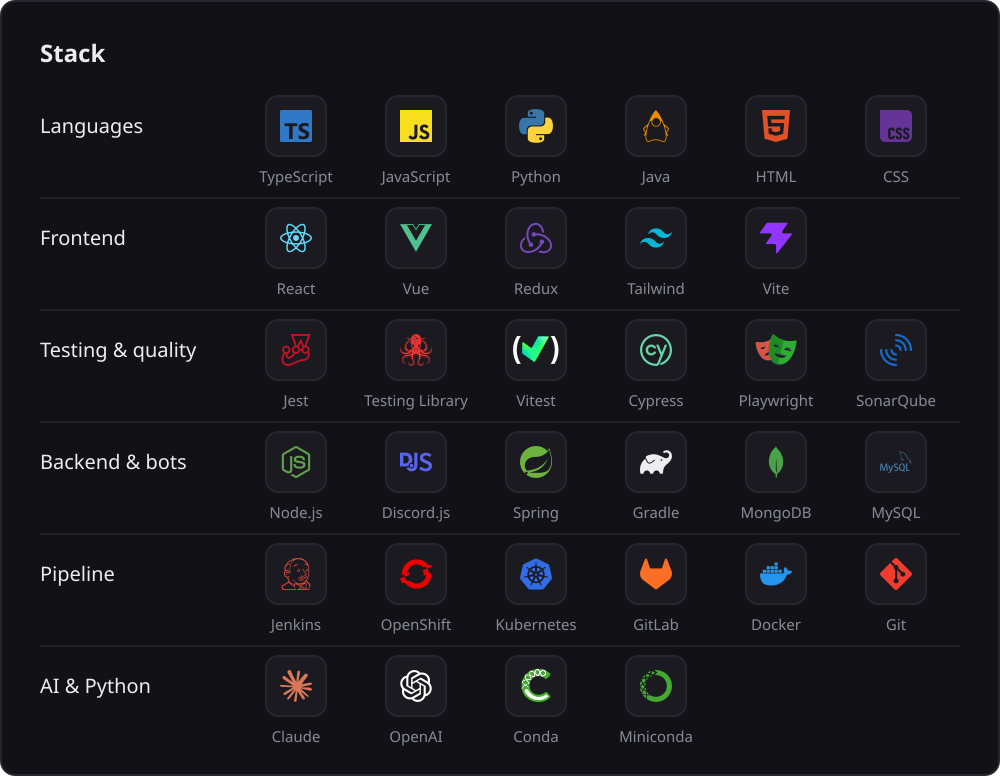

<picture>
  <source media="(prefers-color-scheme: dark)" srcset="https://raw.githubusercontent.com/Kkkermit/Kkkermit/output/snake-crt-dark.svg" />
  
</picture>

#### About

I'm a frontend developer, mostly working in React and TypeScript. In my spare time I build Discord bots, and every so often something in Java.

My main project is [Testify](https://github.com/Kkkermit/Testify), an all-in-one Discord bot I've been working on since 2024. Version 2 was a full rewrite in TypeScript. Every command now works as both a slash and a prefix command, and there are close to 6,000 tests behind it.

I sell some of my bots on [Buy Me a Coffee](https://buymeacoffee.com/kkermit/extras). If you have questions about one, message me on [Discord](https://discord.com/users/526853643962679323).

#### Projects

**[Testify](https://github.com/Kkkermit/Testify)** &nbsp;TypeScript 
All-in-one Discord bot with moderation, economy, music, tickets, games and a web dashboard. Runs at [testify.lol](https://testify.lol).

**[DiscordBotV14-template](https://github.com/Kkkermit/DiscordBotV14-template)** &nbsp;JavaScript 
Discord.js v14 starter with slash and prefix command handlers and MongoDB set up.

**[Statify](https://github.com/Kkkermit/Statify)** &nbsp;Java 
Discord bot in Java (JDA) that shows your Spotify listening stats.

**[jest-ts-example](https://github.com/Kkkermit/jest-ts-example)** &nbsp;TypeScript 
React and TypeScript starter on Vite, set up for Jest, Vitest and Tailwind.

<picture>
  <source media="(max-width: 700px)" srcset="assets/dash-stack-narrow.svg" />
  
</picture>

Stack as text

**Languages:** TypeScript, JavaScript, Python, Java, HTML, CSS 
**Frontend:** React, Vue, Redux, Tailwind, Vite 
**Testing:** Jest, Testing Library, Vitest, JUnit, Cypress, Playwright, Karate, Cucumber, Gherkin 
**Quality and accessibility:** SonarQube, axe, accessibility testing, WCAG 
**Backend and bots:** Node.js, Discord.js, Spring, Gradle, MongoDB, MySQL 
**CI/CD and containers:** Jenkins, OpenShift, Kubernetes, Docker 
**Git and collaboration:** Git, GitHub, GitLab, Bitbucket, Jira, Atlassian 
**AI and Python:** Claude, OpenAI, Conda, Miniconda 
**Platforms:** macOS, Windows, Linux, Debian, Ubuntu

[Discord](https://discord.com/users/526853643962679323) &nbsp;·&nbsp; [Website](https://joshetn.dev) &nbsp;·&nbsp; [Bots for sale](https://buymeacoffee.com/kkermit/extras) &nbsp;·&nbsp; [Buy me a coffee](https://buymeacoffee.com/kkermit)
