 

### `01` &nbsp;ABOUT

Hey, I'm Kkermit. I'm a frontend developer, mostly working with React and TypeScript, and I spend a lot of my spare time building Discord bots. Every now and then I pick up some Java as well.

My main project is [Testify](https://github.com/Kkkermit/Testify), an all-in-one Discord bot I've been working on since 2024. Version 2 was a full rewrite in TypeScript, so every command now runs as both a slash and a prefix command, and the codebase has close to 6,000 tests behind it.

I also sell some of my bots. You can find them on my [Buy Me a Coffee page](https://buymeacoffee.com/kkermit/extras), and if you have any questions about one, message me on [Discord](https://discord.com/users/526853643962679323).

### `02` &nbsp;PROJECTS

### `03` &nbsp;STACK

  

LANGUAGES 

FRONTEND 

TESTING 

BACKEND & BOTS 

PIPELINE 

### `04` &nbsp;STATS

  

<picture>
  <source media="(prefers-color-scheme: dark)" srcset="https://raw.githubusercontent.com/Kkkermit/Kkkermit/output/snake-crt-dark.svg" />
  
</picture>

  

